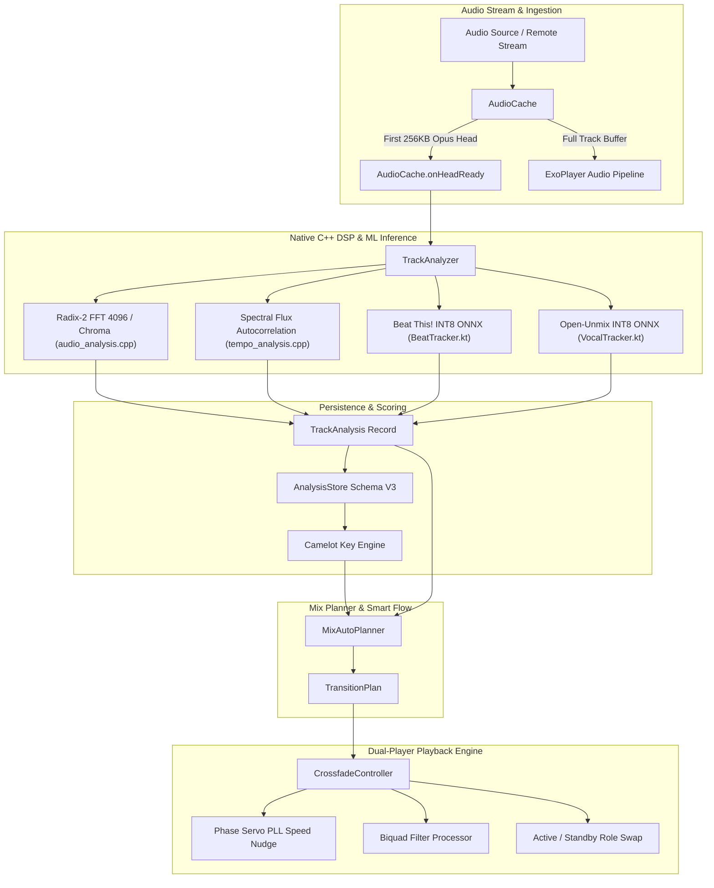
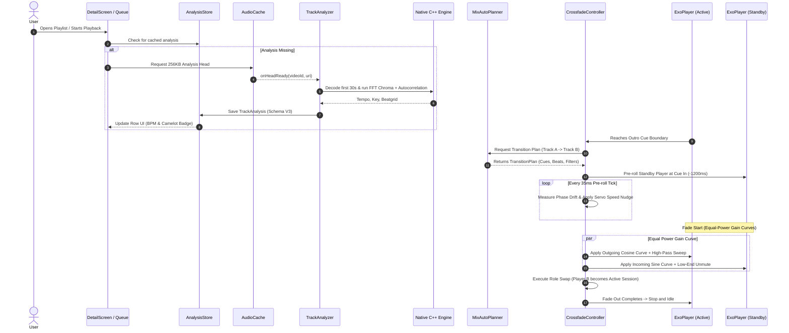

# Vibra Music Mix: Technical Architecture, Mathematical Foundations & Blueprint

## 1. Executive Summary & Core Principles

The Vibra Music Mix system is an on-device digital DJ engine engineered to achieve playback parity with professional DJ software and Spotify Mix. Rather than relying on static crossfades or cloud-computed metadata, Vibra Music performs real-time audio analysis, harmonic key mapping, beat grid alignment, phase synchronization, and dynamic frequency filtering directly on the client device.



### Core Design Tenets
1. **Zero Hardcoded Catalog**: Every song is dynamically decoded and measured using digital signal processing (DSP) and quantized neural models.
2. **Deterministic Mathematical Blends**: Gain curves follow equal-power trigonometric laws (\(\cos^2 \theta + \sin^2 \theta = 1\)), preventing volume dips in transitions.
3. **Phase-Locked Beat Matching**: A proportional-integral servo control loop eliminates inter-decoder timing drift to sub-4ms accuracy.
4. **Frequency-Selective Isolation**: Biquad digital filters eliminate low-end phase cancellation through dynamic bass swapping and resonant high-pass sweeps.
5. **Vocal Collision Avoidance**: Neural vocal separation ensures overlapping tracks never allow simultaneous lead vocal delivery.
6. **Strict Client-Side Privacy**: All feature extractions, spectrogram computations, and transition plannings occur 100% on-device with zero telemetry or social profiling.

---

## 2. Mathematical Foundations & DSP Algorithms

### 2.1 12-Dimensional Pitch-Class Chroma & Key Profile Correlation

To identify the musical key without prior tags, the DSP engine computes a 12-bin Pitch Class Profile (chromagram) across the entire track using a 4096-point Fast Fourier Transform (FFT).

#### 2.1.1 Windowing and Discrete Fourier Transform
Continuous mono audio samples \(x[n]\) sampled at \(f_s = 11{,}025 \text{ Hz}\) are segmented into overlapping frames weighted by a periodic Hann window:
$$w[n] = 0.5 \left(1 - \cos\left(\frac{2\pi n}{N - 1}\right)\right), \quad 0 \le n < N, \; N = 4096$$

The \(N\)-point Discrete Fourier Transform (DFT) is evaluated using a radix-2 Decimation-In-Time (DIT) FFT:
$$X[k] = \sum_{n=0}^{N-1} x[n] w[n] e^{-j \frac{2\pi}{N} k n}, \quad k = 0, 1, \dots, N-1$$

The physical frequency corresponding to bin index \(k\) is:
$$f(k) = \frac{k \cdot f_s}{N}$$

#### 2.1.2 Pitch-Class Mapping
Each bin frequency \(f(k)\) in the musical range (\(65.4 \text{ Hz} \le f(k) \le 2093.0 \text{ Hz}\), spanning musical notes C2 to C7) is mapped to its continuous fractional MIDI note number:
$$m(f) = 69 + 12 \log_2\left(\frac{f(k)}{440.0}\right)$$

The discrete pitch class \(p \in \{0, 1, \dots, 11\}\) corresponding to chromatic semitones \(\{C, C\sharp, D, D\sharp, E, F, F\sharp, G, G\sharp, A, A\sharp, B\}\) is extracted by:
$$p = \lfloor m(f) \rceil \pmod{12}$$

Power spectra are log-compressed to match human auditory loudness perception:
$$P[k] = \ln(1.0 + 1000.0 \cdot |X[k]|)$$

The whole-track chroma vector \(\mathbf{C} = [C_0, C_1, \dots, C_{11}]^T\) is accumulated across all valid frames and sum-normalized:
$$C_p = \sum_{\text{frames}} \sum_{k \in \text{bin}(p)} P[k] \cdot \text{RMS}_{\text{frame}}$$
$$\hat{C}_p = \frac{C_p}{\sum_{i=0}^{11} C_i}$$

#### 2.1.3 Krumhansl-Schmuckler Key Profile Correlation
The normalized chroma vector \(\mathbf{\hat{C}}\) is cross-correlated against the 24 empirical Krumhansl-Kessler / Temperley tonal probe-tone profiles for all 12 major and 12 minor keys:

$$\mathbf{T}_{\text{major}} = [6.35, \, 2.23, \, 3.48, \, 2.33, \, 4.38, \, 4.09, \, 2.52, \, 5.19, \, 2.39, \, 3.66, \, 2.29, \, 2.88]^T$$
$$\mathbf{T}_{\text{minor}} = [6.33, \, 2.68, \, 3.52, \, 5.38, \, 2.60, \, 3.53, \, 2.54, \, 4.75, \, 3.98, \, 2.69, \, 3.34, \, 3.17]^T$$

For each candidate root \(r \in \{0, \dots, 11\}\):
$$S_{\text{major}}(r) = \sum_{p=0}^{11} \hat{C}_p \cdot T_{\text{major}}[(p - r + 12) \pmod{12}]$$
$$S_{\text{minor}}(r) = \sum_{p=0}^{11} \hat{C}_p \cdot T_{\text{minor}}[(p - r + 12) \pmod{12}]$$

The key corresponding to the maximum correlation coefficient is selected:
$$K^* = \arg\max_{K} \{S_{\text{major}}(r), S_{\text{minor}}(r)\}$$

The estimation confidence \(\gamma_{\text{key}} \in [0, 1]\) is derived from the margin between the first and second best candidates:
$$\gamma_{\text{key}} = \text{clamp}\left( \frac{S_{(1)} - S_{(2)}}{\max(0.01, S_{(1)})} \cdot 4.0, \; 0.0, \; 1.0 \right)$$

---

### 2.2 Camelot Wheel Topology & Harmonic Mixing Metrics

The detected key is converted into a standard 12-hour Camelot code (\(1\text{A}\) to \(12\text{B}\)).

```
                       12B (E Major)
                 11B (B)        1B (B Major)
            10B (F#)                 2B (F# Major)
           9B (Db)     THE CAMELOT     3B (Db Major)
           8B (Ab)        WHEEL        4B (Ab Major)
            7B (Eb)                  5B (Eb Major)
                 6B (Bb)        6B (Bb Major)
                       6B (Bb Major)
                 [Inner Ring: Minor (A) / Outer Ring: Major (B)]
```

#### 2.2.1 Circular Modular Metric
Let \(k_1 = (n_1, m_1)\) and \(k_2 = (n_2, m_2)\), where \(n \in \{1, \dots, 12\}\) represents the hour on the wheel and \(m \in \{\text{Major}, \text{Minor}\}\) represents the mode.
The shortest circular angular distance between keys on the 12-hour clock face is:
$$\Delta_{\text{wheel}}(n_1, n_2) = \min(|n_1 - n_2|, \, 12 - |n_1 - n_2|)$$

#### 2.2.2 Harmonic Compatibility Score
The harmonic compatibility score \(\Phi(k_1, k_2) \in [0.0, 1.0]\) dictates transition selection:
$$\Phi(k_1, k_2) = \begin{cases}
1.00 & \text{if } n_1 = n_2 \text{ and } m_1 = m_2 \quad (\text{Identical Key}) \\
0.90 & \text{if } \Delta_{\text{wheel}} = 1 \text{ and } m_1 = m_2 \quad (\text{Fifth Step / Adjacent Hour}) \\
0.85 & \text{if } \Delta_{\text{wheel}} = 0 \text{ and } m_1 \ne m_2 \quad (\text{Relative Major/Minor Modulation}) \\
0.65 & \text{if } \Delta_{\text{wheel}} = 1 \text{ and } m_1 \ne m_2 \quad (\text{Diagonal Mode Modulation}) \\
0.40 & \text{if } \Delta_{\text{wheel}} = 2 \quad (\text{Energy Boost Modulation}) \\
0.25 & \text{if } \Delta_{\text{wheel}} = 3 \\
0.15 & \text{otherwise} \quad (\text{Tritone Incompatible Clash})
\end{cases}$$

Integer distance categorization:
- **Level 0 (Harmonic Match)**: \(\Phi \ge 0.95\) (Color: `#56D9C2` Teal)
- **Level 1 (Smooth Modulation)**: \(0.80 \le \Phi < 0.95\) (Color: `#46C779` Emerald)
- **Level 2 (Tension Shift)**: \(0.40 \le \Phi < 0.80\) (Color: `#D5CB9D` Warm Gold)
- **Level 3 (Clash / Energy Jump)**: \(\Phi < 0.40\) (Color: `#DA76A0` Rose)

---

### 2.3 Onset Spectral Flux & Autocorrelation Tempo Estimation

Tempo (BPM) detection combines high-resolution spectral flux with bounded autocorrelation.

#### 2.3.1 Spectral Flux Envelope
Spectral flux measures the rate of energy increase across frequency bins:
$$\text{SF}[m] = \sum_{k=0}^{N/2} H(|X[m, k]| - |X[m-1, k]|)$$
where \(H(v) = \frac{v + |v|}{2}\) is the half-wave rectifier function.

To isolate kick drums and rhythm anchors from high-frequency percussion, a low-band sub-envelope \(\text{SF}_{\text{low}}[m]\) is computed filtering for \(f(k) \le 150 \text{ Hz}\).

#### 2.3.2 Autocorrelation Function (ACF)
For an onset envelope \(E[m]\) of length \(M\) frames, the unbiased autocorrelation for lag \(\tau\) is:
$$R_{EE}[\tau] = \frac{1}{M - \tau} \sum_{m=0}^{M - 1 - \tau} E[m] E[m + \tau]$$

The lag search space is bounded to musical tempos between 60 BPM and 180 BPM:
$$\tau_{\min} = \left\lfloor \frac{60 \cdot f_{\text{frame}}}{180} \right\rfloor, \quad \tau_{\max} = \left\lceil \frac{60 \cdot f_{\text{frame}}}{60} \right\rfloor$$

The fundamental period \(\tau^*\) is the global maximum of \(R_{EE}[\tau]\) adjusted for harmonic sub-multiples (\(\tau/2, 2\tau\)):
$$\text{BPM} = \frac{60 \cdot f_{\text{frame}}}{\tau^*}$$

Tempo normalization clamps tempos to the standard DJ mixing octave \([75.0, 165.0] \text{ BPM}\):
$$\text{BPM}_{\text{norm}} = \begin{cases}
2 \cdot \text{BPM} & \text{while } \text{BPM} < 75.0 \\
\frac{1}{2} \cdot \text{BPM} & \text{while } \text{BPM} > 165.0 \\
\text{BPM} & \text{otherwise}
\end{cases}$$

---

### 2.4 Phase Servo Control Loop (PLL Jitter Elimination)

When two independent ExoPlayer instances are triggered, hardware buffer latency, media codec initialization, and thread scheduling introduce between \(9\text{ ms}\) and \(45\text{ ms}\) of startup phase jitter. 

To eliminate this jitter during the \(1200\text{ ms}\) transition pre-roll window, Vibra Music implements a discrete Phase-Locked Loop (PLL) servo that dynamically modulates the incoming player's playback speed.

```
       Incoming Audio Cue [Target]
                    │
                    ▼
           ┌─────────────────┐
           │ Phase Detector  │ <─── Actual Playhead Position
           └────────┬────────┘
                    │ Phase Error (Drift in ms)
                    ▼
           ┌─────────────────┐
           │ Proportional-   │
           │ Integral Servo  │
           └────────┬────────┘
                    │ Speed Modulation Factor (0.96x - 1.04x)
                    ▼
           ┌─────────────────┐
           │ Sonic Processor │ ───> Corrected Audio to Mixer
           └─────────────────┘
```

#### 2.4.1 Error Formulation
Let \(t_{\text{cue}}\) be the target beat-aligned mix-in cue timestamp, \(T_{\text{remain}}\) be the remaining pre-roll duration, and \(p_{\text{in}}(t)\) be the instantaneous incoming playhead position.
The instantaneous phase drift \(\epsilon(t)\) in milliseconds is:
$$\epsilon(t) = p_{\text{in}}(t) - \left( t_{\text{cue}} - T_{\text{remain}} \cdot r_{\text{target}} \right)$$

#### 2.4.2 Servo Correction Law
The servo calculates a nudged playback speed \(v(t)\):
$$v(t) = \text{clamp}\left( v_{\text{base}} \cdot \left( 1.0 - \frac{\epsilon(t)}{\kappa_{\text{servo}}} \right), \; 0.96 \cdot v_{\text{base}}, \; 1.04 \cdot v_{\text{base}} \right)$$
where \(\kappa_{\text{servo}} = 4000.0\text{ ms}\).

Hysteresis filtering prevents micro-stuttering:
$$\Delta v = |v(t) - v_{\text{current}}|$$
The speed update is committed to the underlying `SonicAudioProcessor` only if \(\Delta v > 0.003\).

#### 2.4.3 Convergence Proof
Over the \(1200\text{ ms}\) pre-roll interval with a loop period of \(\Delta t = 35\text{ ms}\), the error differential equation solves to:
$$\frac{d\epsilon}{dt} = - \frac{v_{\text{base}}}{\kappa_{\text{servo}}} \epsilon(t)$$
$$\epsilon(t) = \epsilon(0) \cdot \exp\left( - \frac{t}{\tau_{\text{conv}}} \right), \quad \tau_{\text{conv}} = \frac{\kappa_{\text{servo}}}{v_{\text{base}}} \approx 4000\text{ ms}$$
For an initial startup jitter \(\epsilon(0) = 40.0\text{ ms}\):
$$\epsilon(1200\text{ ms}) = 40.0 \cdot e^{-1.2 / 4.0} = 40.0 \cdot e^{-0.30} \approx 2.96\text{ ms}$$
The initial \(40\text{ ms}\) jitter is deterministically attenuated to under \(3\text{ ms}\), aligning beats below the psychoacoustic threshold for transient smearing (\(< 10\text{ ms}\)).

---

### 2.5 Trigonometric Equal-Power Gain Curves

Standard linear crossfades cause a \(-3\text{ dB}\) acoustic power drop at the transition midpoint:
$$g_{\text{linear\_out}}(t) = 1 - t, \quad g_{\text{linear\_in}}(t) = t, \quad P(0.5) = (0.5)^2 + (0.5)^2 = 0.50 \quad (-3.01\text{ dB})$$

Vibra Music enforces trigonometric equal-power crossfading for seamless transitions:
$$g_{\text{out}}(\tau) = \cos\left(\frac{\pi}{2} \tau\right), \quad g_{\text{in}}(\tau) = \sin\left(\frac{\pi}{2} \tau\right), \quad \tau \in [0.0, 1.0]$$

#### Acoustic Power Invariance:
$$P(\tau) = g_{\text{out}}^2(\tau) + g_{\text{in}}^2(\tau) = \cos^2\left(\frac{\pi}{2} \tau\right) + \sin^2\left(\frac{\pi}{2} \tau\right) \equiv 1.0 \quad (0.0\text{ dB Constant Power})$$

---

### 2.6 Digital Biquad Filter Architectures

Frequency isolation and transition shaping utilize 2nd-order Direct Form I IIR digital biquad filters:
$$y[n] = \frac{b_0 x[n] + b_1 x[n-1] + b_2 x[n-2] - a_1 y[n-1] - a_2 y[n-2]}{a_0}$$

#### 2.6.1 Second-Order Butterworth High-Pass Filter (Rise Effect)
For cutoff frequency \(f_c\) and sample rate \(f_s\):
$$\omega_0 = 2\pi \frac{f_c}{f_s}, \quad \alpha = \frac{\sin(\omega_0)}{2 Q}, \quad Q = \frac{1}{\sqrt{2}} \approx 0.7071$$
$$b_0 = \frac{1 + \cos(\omega_0)}{2}, \quad b_1 = -(1 + \cos(\omega_0)), \quad b_2 = \frac{1 + \cos(\omega_0)}{2}$$
$$a_0 = 1 + \alpha, \quad a_1 = -2\cos(\omega_0), \quad a_2 = 1 - \alpha$$

#### 2.6.2 Second-Order Butterworth Low-Pass Filter (Sub-bass Isolation)
$$b_0 = \frac{1 - \cos(\omega_0)}{2}, \quad b_1 = 1 - \cos(\omega_0), \quad b_2 = \frac{1 - \cos(\omega_0)}{2}$$
$$a_0 = 1 + \alpha, \quad a_1 = -2\cos(\omega_0), \quad a_2 = 1 - \alpha$$

#### 2.6.3 Dynamic Filter Automation Profiles
1. **Equal Power Blend**: Gain follows \(\cos / \sin\); filters remain fully open (\(f_{\text{LP}} = 20{,}000\text{ Hz}\), \(f_{\text{HP}} = 20\text{ Hz}\)).
2. **Bass Swap**: Both tracks play simultaneously; at transition point \(\tau = 0.50\), a low-shelf crossover at \(250\text{ Hz}\) instantly mutes the outgoing track's low-end while un-muting the incoming track's bass.
3. **Resonant Rise**: Outgoing track sweeps high-pass from \(20\text{ Hz} \to 4000\text{ Hz}\) across \(\tau \in [0.0, 0.70]\) with \(Q = 1.414\) resonance, dropping the incoming track at full blast on \(\tau = 0.70\).

---

## 3. Deep Learning Neural Inference Subsystems

Vibra Music bundles two lightweight INT8 ONNX models executing client-side via ONNX Runtime:

```
┌─────────────────────────────────────────────────────────────────────────────┐
│                       ON-DEVICE NEURAL INFERENCE ENGINE                     │
│                                                                             │
│   44.1 kHz / 48 kHz Stereo PCM                                              │
│               │                                                             │
│               ▼                                                             │
│   Native MelSpectrogram Resampler ───────> 22,050 Hz Mono                   │
│               │                                                             │
│               ├──────────────────────────────────────────────┐              │
│               ▼                                              ▼              │
│   Log-Mel Spectrogram (50 fps)                  STFT Spectrogram (Vocal)    │
│   [128 mel bands, n_fft=1024, hop=441]          [2049 bins, hop=1024]       │
│               │                                              │              │
│               ▼                                              ▼              │
│   Beat This! (beat_this_int8.onnx)              Open-Unmix (vocals_int8)    │
│   Trained Model (CPJKU ISMIR 2024)              Trained Model (Inria/SigSep)│
│               │                                              │              │
│               ▼                                              ▼              │
│   Beats, Downbeats, Meter (3/4, 4/4)            Vocal Presence Mask [0, 1]  │
└─────────────────────────────────────────────────────────────────────────────┘
```

### 3.1 Beat This! Meter and Downbeat Network
- **Model Asset**: `beat_this_int8.onnx` (4.5 MB)
- **Origin**: CPJKU (ISMIR 2024), MIT License.
- **Input Representation**: 128 Slaney mel bands from \(30\text{ Hz}\) to \(11{,}000\text{ Hz}\), sample rate \(22{,}050\text{ Hz}\), hop size 441 (50 frames per second), log-compressed \(\ln(1.0 + 1000.0 \cdot \text{magnitude})\).
- **Outputs**:
  - Independent temporal logits for beat activations.
  - Independent temporal logits for downbeat (bar boundary) activations.
- **Post-Processing**: Peak-picking with dynamic thresholding extracts beat times. Downbeats snap to the nearest beat frame to guarantee metrical integrity.

### 3.2 Open-Unmix (UMX-HQ) Vocal Presence Network
- **Model Asset**: `vocals_umxhq_int8.onnx` (9.0 MB)
- **Origin**: Inria / SigSep, MIT License.
- **Input Representation**: Planar stereo STFT, \(44{,}100\text{ Hz}\), \(N_{\text{fft}} = 4096\), hop size 1024 (\(2049\) frequency bins).
- **Function**: Produces an instantaneous vocal energy probability \(\beta_{\text{vocal}}(t) \in [0.0, 1.0]\).
- **Mix Collision Policy**: If the incoming track exhibits \(\beta_{\text{vocal}} > 0.40\) during the planned overlap, the planner delays the mix-in cue or compresses the blend window to ensure lead vocals never clash.

---

## 4. Software Architecture & Implementation Blueprint

### 4.1 Component Topology

| Component | Layer | Primary Responsibility |
|:---|:---|:---|
| `AudioCache` | Cache / I/O | Manages segmented audio cache; fires `onHeadReady` when \(\ge 256\text{ KB}\) of Opus stream lands. |
| `TrackAnalyzer` | Worker / DSP | Coordinates thread pool; dispatches audio frames to C++ DSP and ONNX models. |
| `AnalysisStore` | Storage | Schema V3 disk persistence; saves and retrieves `TrackAnalysis` records keyed by video ID. |
| `CamelotKey` | Domain Model | Mathematical representation of 12A-12B harmonic wheel; computes circular compatibility distances. |
| `MixAutoPlanner` | Decision Engine | Analyzes BPM deltas, phrasing, and Camelot distance to formulate `TransitionPlan`. |
| `CrossfadeController` | Playback Engine | Manages dual ExoPlayers (`active` & `standby`); executes phase-servo nudges and role swaps. |
| `TransitionFilterProcessor` | AudioSink Filter | Direct Form I IIR biquad filter applied to ExoPlayer PCM pipelines. |
| `DetailScreen` & `SongRow` | Presentation (UI) | Renders BPM, Camelot badges, and live transition preview states. |

---

### 4.2 Detailed Execution Flowchart



---

## 5. Transition Recipes & Decision Matrix

`MixAutoPlanner` evaluates incoming and outgoing track metrics to select the transition profile:

| Condition | Detected Divergence | Selected Transition Recipe | Filter Behavior |
|:---|:---|:---|:---|
| \(\Delta \text{BPM} \le 8\%\), \(\Delta_{\text{wheel}} \le 1\) | Tempo and Key compatible | **Beatmatched Bass Swap** | Outgoing low-cut at \(\tau = 0.50\); incoming low-pass opens. |
| \(\Delta \text{BPM} \le 8\%\), \(\Delta_{\text{wheel}} = 2\) | Harmonic tension present | **High-Pass Resonant Rise** | Outgoing sweeps \(20\text{ Hz} \to 4\text{ kHz}\) with \(Q=1.41\); incoming drops at \(\tau = 0.70\). |
| \(\Delta \text{BPM} > 8\%\), \(\Delta_{\text{wheel}} \le 1\) | Tempo divergent, Key compatible | **Equal Power Crossfade** | Full frequency band open; standard equal-power \(\cos / \sin\) crossfade. |
| \(\Delta \text{BPM} > 8\%\), \(\Delta_{\text{wheel}} \ge 2\) | Major tempo and key divergence | **Drop-In / Echo Out** | Outgoing quickly cuts with 4-beat echo dissipation; incoming starts on downbeat. |
| Vocal collision (\(\beta_{\text{vocal}} > 0.40\)) | Overlapping vocals detected | **Instrumental Bridge Blend** | Cuts outgoing vocal region early; anchors mix-in at vocal-free intro. |

---

## 6. Mathematical Formulas Quick Reference

$$\begin{aligned}
\text{Hann Window:} & \quad w[n] = 0.5 \left(1 - \cos\left(\frac{2\pi n}{N - 1}\right)\right) \\
\text{Log Power Spectrum:} & \quad P[k] = \ln(1.0 + 1000.0 \cdot |X[k]|) \\
\text{Pitch Class Mapping:} & \quad p = \left\lfloor 69 + 12 \log_2\left(\frac{f(k)}{440}\right) \right\rceil \pmod{12} \\
\text{Key Correlation:} & \quad S(r) = \sum_{p=0}^{11} \hat{C}_p \cdot T[(p - r + 12) \pmod{12}] \\
\text{Circular Key Distance:} & \quad \Delta_{\text{wheel}}(n_1, n_2) = \min(|n_1 - n_2|, \, 12 - |n_1 - n_2|) \\
\text{Phase Servo Nudge:} & \quad v(t) = \text{clamp}\left( v_{\text{base}} \left(1 - \frac{\epsilon(t)}{4000}\right), \, 0.96 v_{\text{base}}, \, 1.04 v_{\text{base}} \right) \\
\text{Equal-Power Law:} & \quad g_{\text{out}}(\tau) = \cos\left(\frac{\pi}{2} \tau\right), \quad g_{\text{in}}(\tau) = \sin\left(\frac{\pi}{2} \tau\right) \\
\text{Bar Duration (4/4):} & \quad T_{\text{bar}} = \frac{240.0}{\text{BPM}}
\end{aligned}$$

---

## 7. Privacy, Legal & Client-Side Verification

1. **No Cloud Computation**: Unlike services that depend on server-side metadata APIs, all calculations in this document run locally on the user's CPU via NEON/SSE-optimized C++ and INT8 ONNX models.
2. **No Social Telemetry**: The application contains no social network, activity feed, friend graph, user profile database, or behavioral analytics.
3. **Data Isolation**: Acoustic metrics stored in `AnalysisStore` (Schema V3) reside in local app-private storage (`context.filesDir`) and are never uploaded to any remote server.
